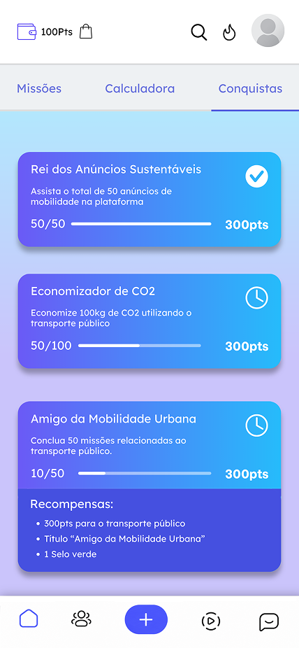

# **SoulMove - by Antípoda**

===================================================

## Resumo do nosso projeto:
A SoulMove é um projeto que tem como objetivo incentivar o uso do transporte público por meio de recompensas, missões e elementos de gamificação, promovendo a mobilidade sustentável e contribuindo para a redução da emissão de poluentes causados pelos veículos particulares.

O sistema conta com funcionalidades como calculadora de emissão de carbono, conversão de pontos em passagens e métodos de comprovação das atividades realizadas.

Além disso, nossa equipe desenvolveu um site (tema deste README) para apresentar o projeto, a equipe responsável e os princípios da SoulMove, reforçando nosso compromisso com a sustentabilidade e a melhoria da qualidade de vida da população.

> **Atualização:** o front-end do projeto migrou da estrutura original em HTML, CSS e JavaScript puros para uma aplicação **React** construída com **TypeScript** e **Vite**. As seções abaixo foram atualizadas para refletir essa nova stack.

===================================================

## Links do projeto:
- **Repositório:** https://github.com/paulo-henrique253/soulmove
- **Vídeo:** https://youtu.be/TW6Z4w18r3I
- **Vercel:** https://soulmove-xi.vercel.app/
- **API:** https://soulmove-java-3.onrender.com

===================================================

## Como rodar o projeto:
Crie um arquivo `.env` na raiz do projeto com o endereço da API:

```
VITE_API_URL=https://soulmove-java-3.onrender.com
```

Depois, no terminal:

```
npm install
npm run dev
```

Para gerar e visualizar a build de produção:

```
npm run build
npm run preview
```

===================================================

## Tecnologias utilizadas:

### Principal:
- **React** - utilizado para construir a interface em componentes reutilizáveis;
- **TypeScript** - utilizado para tipagem, aplicada a todos os componentes, páginas e dados do projeto;
- **Vite** - ferramenta de build e servidor de desenvolvimento;
- **React Router** - utilizado para gerenciar as rotas da aplicação, incluindo rotas dinâmicas como a página individual de cada integrante;
- **Tailwind CSS** - utilizado para toda a estilização do projeto, com classes utilitárias, mantendo responsividade do  projeto;
- **React Hook Form** - utilizado para controlar o formulário de contato, validação de campos obrigatórios e exibição de mensagens de erro; 
                                OBS IMPORTANTE: este conteúdo não foi trabalhado durante as aulas antes da entrega da sprint, mas continuou como requisito obrigatório, sendo assim, os                                      responsáveis pelo projeto foram atrás de como implementar essa tecnologia na aplicação.

### Estrutura em componentes:
A aplicação foi reorganizada em componentes React reutilizáveis, entre eles:
- `Header` e `Footer`: cabeçalho e rodapé presentes em todas as páginas, renderizados a partir de um layout compartilhado (`MainLayout`);
- `MenuNavegacao` e `MenuFooter`: menus de navegação do header e do footer;
- `TituloPagina`: título padronizado usado no topo das páginas internas;
- `CalculadoraCarbono`: calculadora de emissão de carbono da página **Sobre**;
- `ImagemInterativa`: componente reutilizável para as imagens que trocam de aparência ao passar o cursor (usado na página **Funcionalidades**);
- `CardFuncionalidade`: card de apresentação de cada funcionalidade do sistema;
- `FaqCard`: card de pergunta/resposta com efeito de **accordion** na página **FAQ**;
- `ContatoInput` e `ContatoTextarea`: campos de formulário controlados via React Hook Form, com exibição de erros de validação;
- `IntegranteCard`: card de cada integrante exibido na página **Integrantes**, com link para a página individual do membro;
- `TextoDestaque` e `TextoRoadmap`: blocos de texto reutilizados na página inicial e no roadmap.

### Roteamento:
A navegação entre páginas deixou de depender de arquivos `.html` separados e passou a ser feita via **React Router**, dentro de uma única aplicação (SPA). As rotas configuradas são:
- `/` - Página inicial do projeto;
- `/sobre` - Sobre o projeto;
- `/funcionalidades` - Funcionalidades do sistema;
- `/roadmap` - Visão de futuro do projeto;
- `/integrantes` - Integrantes (lista da equipe);
- `/integrantes/:slug` - página individual de cada integrante, gerada dinamicamente a partir do slug;
- `/faq` - Perguntas frequentes;
- `/contato` - Contato com a equipe do projeto;
- `/login` - Login do administrador;
- `/appInicio`, `/appCalculadora`, `/appCarteira`, `/appMissoes`, `/appPerfil`, `/appRecarga`, `/appConquistas` - telas do aplicativo SoulMove;
- `/appMissoes/:slug` - detalhe de cada missão, gerado a partir do parâmetro da rota;
- `/appLogin` e `/appCadastro` - login e cadastro dos usuários do aplicativo;
- `/adm` - painel do administrador, com as rotas `/adm/missoes`, `/adm/conquistas`, `/adm/novaMissao` e `/adm/novaConquista`;
- `/adm/missoes/:missaoId` e `/adm/conquistas/:conquistaId` - edição de cada missão e conquista.

As telas do aplicativo usam o `AppLayout`, dentro do `MainLayout`.

Todas as rotas compartilham o mesmo layout (`MainLayout`), que renderiza o `Header`, o conteúdo da página/main (utilizando o `Outlet`) e o `Footer`.

### Estilização com Tailwind CSS:
- O layout é construído inteiramente com classes utilitárias do Tailwind, sem a necessidade de um arquivo CSS customizado extenso (o `index.css` apenas importa o Tailwind);
- Ainda utilizamos as fontes **Lexend Deca** e **Momo Trust Display**, importadas via Google Fonts diretamente no `index.html`;
- A responsividade continua seguindo a abordagem **mobile first**, agora usando os prefixos de breakpoint do Tailwind (`sm:`, `md:`, `lg:`);
- Efeitos visuais como `hover` são utilizados no site.

### Interatividade:
- **Calculadora de emissão de carbono** (página **Sobre**): reescrita como componente React (`CalculadoraCarbono`), utilizando `useState` para armazenar a quilometragem digitada e exibir o resultado calculado;
- **Formulário de contato** (página **Contato**): reescrito com **React Hook Form**, validando campos obrigatórios (nome, e-mail e mensagem), formato de e-mail e exibindo uma modal de confirmação (controlada por `useState`) após o envio bem-sucedido;
- **Accordion do FAQ**: cada `FaqCard` controla a exibição da resposta ao ser clicado;
- **Menu hambúrguer**: o `Header` controla a exibição do menu mobile, que é renderizado pelo componente `MenuNavegacao`;
- **Imagens interativas** (página **Funcionalidades**): o componente `ImagemInterativa` alterna entre duas imagens ao passar o cursor ou tocar na tela, usando classes do Tailwind (`group-hover`, `group-focus`) para a transição.

===================================================

## Estrutura de pastas do projeto:

Com a migração para React + Vite, a estrutura de pastas também mudou. O projeto agora segue a organização padrão de uma aplicação Vite/React:

- `src/pages/`: contém as páginas da aplicação;
    - `Index.tsx`: página principal do site, com apresentação inicial do projeto;
    - `Sobre.tsx`: contextualização da solução e introdução ao problema abordado, incluindo a calculadora de carbono;
    - `Funcionalidades.tsx`: demonstração e explicação das funcionalidades da SoulMove;
    - `Roadmap.tsx`: página focada na visão de negócio e futuro da SoulMove;
    - `Integrantes.tsx`: listagem da equipe com links para GitHub e LinkedIn;
    - `Integrante.tsx`: página individual de cada integrante, acessada via rota dinâmica;
    - `Faq.tsx`: página com perguntas frequentes;
    - `Contato.tsx`: formulário para envio de dúvidas, sugestões e mensagens.

- `src/components/`: componentes reutilizáveis em toda a aplicação.

- `src/layouts/`: contém o `MainLayout.tsx`, responsável por estruturar o `Header`, o conteúdo de cada página e o `Footer` em todas as rotas.

- `src/pages/app/`: telas do aplicativo SoulMove (início, calculadora, carteira, missões, perfil, recarga, conquistas, login e cadastro);

- `src/pages/adm/`: painel do administrador (cadastro, lista e edição de missões e conquistas);

- `src/service/`: funções que fazem as requisições à API (`missao.ts`, `conquista.ts`, `usuario.ts`, `viagem.ts` e `recarga.ts`);

- `src/types/`: tipos TypeScript dos dados que vêm da API;

- `src/contexts/` e `src/hooks/`: `UsuarioContext`, `UsuarioProvider` e `useUsuario`, que guardam o usuário logado;

- `vercel.json`: redireciona todas as rotas para o `index.html`, para a SPA funcionar na Vercel.

- `src/data/`: arquivos de dados tipados em TypeScript que alimentam os componentes.

- `src/assets/`: imagens e ícones utilizados no site.

- `src/App.tsx`: define as rotas da aplicação com o React Router.

- `src/main.tsx`: ponto de entrada da aplicação, onde o `App` é renderizado.

- `index.html`: HTML base utilizado pelo Vite, contendo o elemento raiz (`#root`) e a importação das fontes do Google Fonts.

- `vite.config.ts`: configuração do Vite, incluindo os plugins do React e do Tailwind CSS.

===================================================

## Imagens do projeto

### Telas do aplicativo

<table align="center">
  <tr>
    <td align="center"><br><b>Carteira</b></td>
    <td align="center"><br><b>Missões</b></td>
    <td align="center"><br><b>Calculadora</b></td>
  </tr>
  <tr>
    <td align="center"><br><b>Recarga</b></td>
    <td align="center"><br><b>Comprovação</b></td>
    <td align="center"><br><b>Conquistas</b></td>
  </tr>
</table>

### Roadmap


===================================================

## Autores e créditos:


**Enzo Zeni - 1TDSPK - RM570653**
  - Linkedin: https://www.linkedin.com/in/enzo-fachinelli-zeni-687a873b3
  - Github: https://github.com/F-Zeni

<br>


**Jacqueline Lotufo - 1TDSPK - RM571390**
  - Linkedin: https://br.linkedin.com/in/jacqueline-lotufo
  - Github: https://github.com/jacquelot

<br>


**Julia de Freitas - 1TDSPK - RM569098**
  - Linkedin: https://www.linkedin.com/in/lixzaura
  - Github: https://github.com/lixzaura

<br>


**Paulo Henrique - 1TDSPK - RM573806**
  - Linkedin: https://www.linkedin.com/in/paulo-henrique-gomes-gonçalves-aa04b5272/
  - Github: https://github.com/paulo-henrique253

<br>


**Danielle Kagan - 1TDSPK - RM569359**
  - Linkedin: https://www.linkedin.com/in/danielle-fernanda-kagan-9026b141b/
  - Github: https://github.com/daniellekgn


===================================================

## Contato
Nosso principal meio de contato é o e-mail:

- grupoantipoda.challenge@gmail.com

Porém, cada integrante possui seu e-mail institucional da FIAP:
- Enzo: RM570653@fiap.com.br
- Jacqueline: RM571390@fiap.com.br
- Julia: RM569098@fiap.com.br
- Paulo: RM573806@fiap.com.br
- Danielle: RM569359@fiap.com.br
